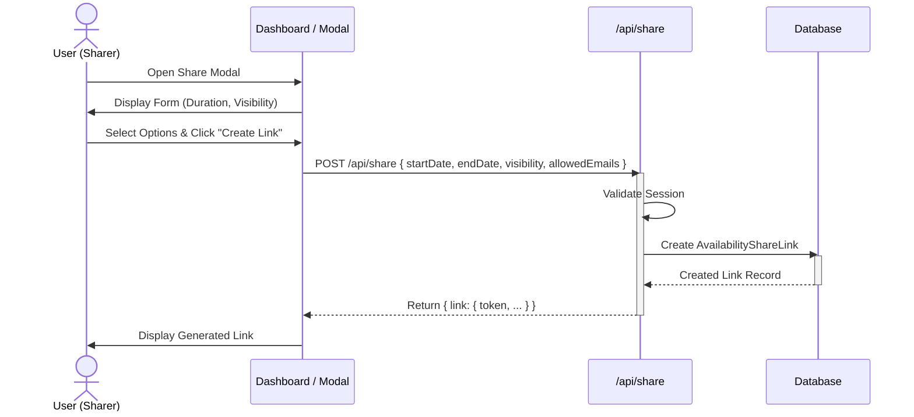
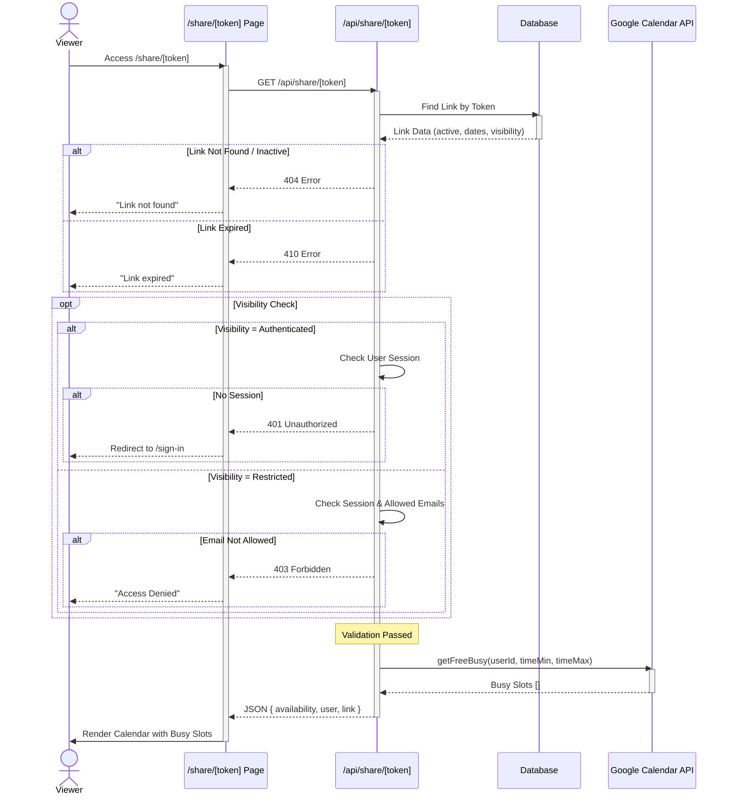

# Sequence Diagrams: Availability Sharing

## Create Share Link Flow
This diagram illustrates the process of a user creating a new shared availability link.

## View Shared Availability Flow
This diagram illustrates the process of an external user (or the same user) accessing a shared availability link.

